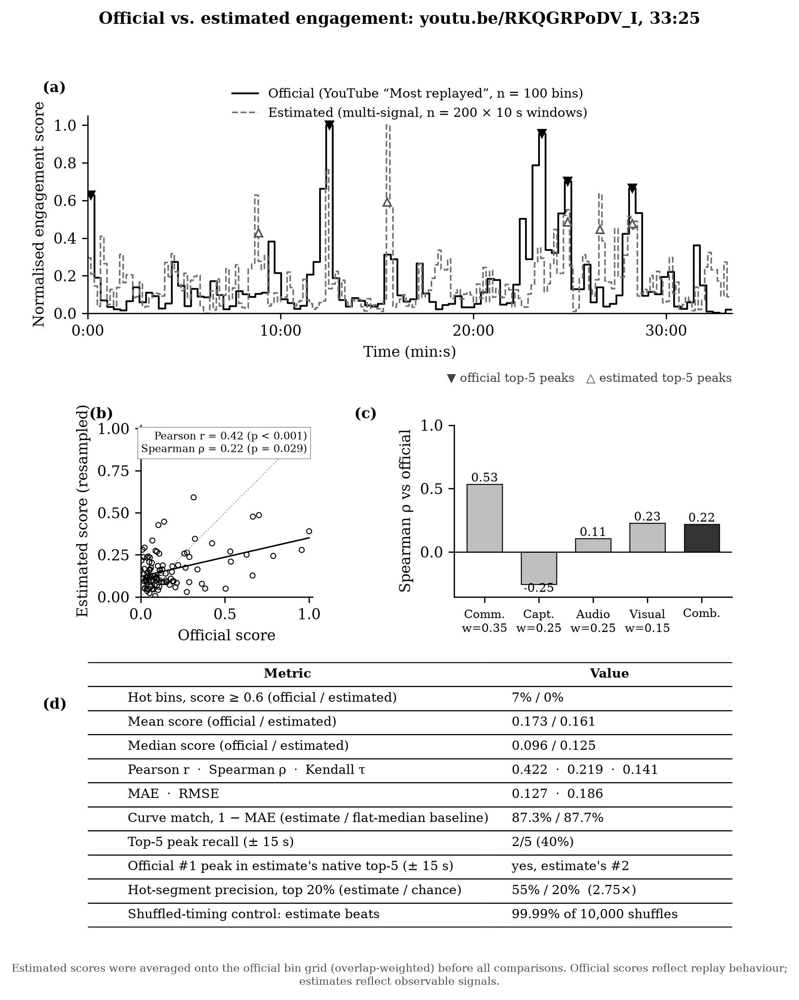

# youtu.be/RKQGRPoDV_I, Heatmapify v1.4

24M views · 30,203 comments · 33:25 · 264 timestamped comments used by the estimate.
Official is YouTube's "Most replayed" curve: 100 bins × 20.05 s. Estimated is a forced estimate: 200 windows × 10 s, averaged onto the official bins (overlap-weighted).

## Headline numbers

| Claim | Value | What it means |
|---|---|---|
| Official #1 replay moment found | yes (12:22–12:42 is the estimate's #2 window) | The most-replayed moment on YouTube is in our top 2, at native 10 s resolution. On the 20 s grid it averages down to rank 6. |
| Hot-segment precision | 55% vs 20% chance (2.75×) | We marked the top 20 of 100 slices as hot, and 11 really were. Darts would land about 4. |
| Shuffled-timing control | beats 99.99% of 10,000 shuffles | We kept our scores but scrambled their order. Almost every scrambled version matched YouTube worse, so the timing isn't luck. This is generous, because neighbouring slices are correlated. |
| Top-5 peak recall (±15 s) | 2/5 (40%) | Of YouTube's five biggest spikes, we caught two (#3 at 24:54, #4 at 28:14). |
| Ranking | Spearman ρ 0.22 (p = 0.029); (Kendall τ + 1)/2 = 57% | Slice pairs ordered correctly; 50% would be chance. |
| Average level | 0.173 official vs 0.161 estimated | The v1.4 shape calibration fixed v1.3's over-estimate. |

## How "87% curve match" is computed, and why it isn't a headline on its own

1. Put both curves on the same 100 bins, scored 0–1.
2. For each bin, take |official − estimate|.
3. Average the 100 gaps: MAE = 0.127 (SD 0.137, worst bin 0.68).
4. Curve match = 1 − MAE = **87.3%** (bootstrap 95% CI 84.5–89.9%).

| Predictor | 1 − MAE |
|---|---|
| Heatmapify estimate | 87.3% |
| Flat line at the official median | 87.7% |
| Flat line at the official mean | 85.7% |
| Estimate with timing shuffled (mean of 10k) | 84.3% |

Most of YouTube's curve sits near 0.1, so a flat line scores about as well. Curve match measures overall closeness, not whether the spikes were found. Read it together with the peak, hot-segment and shuffle numbers above.

## Per-signal view

Spearman ρ against official: comments 0.53, captions −0.25, audio 0.11, visual 0.23, combined 0.22.
Captions run against replays in this horror let's play, where talk is dense everywhere, and that drags the blend down. Recomputing the raw linear blend without v1.4's shape calibration gives:

| Blend | ρ | Peaks (of 5) |
|---|---|---|
| Default (0.35/0.25/0.25/0.15) | 0.19 | 2 |
| Comments only | 0.53 | 4 |
| Comments 0.6, visual 0.25, audio 0.15 | 0.42 | 3 |
| Drop captions (0.47/0.33/0.20) | 0.32 | 3 |

This is in-sample on one video, so it's a lead, not new weights. Weights should be fitted across the benchmark set with leave-one-video-out validation.
